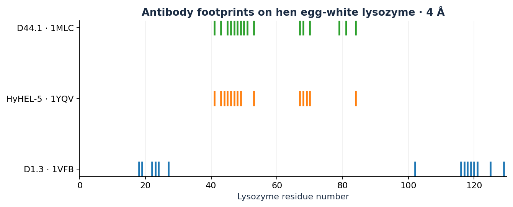

# Lysozyme antibody interfaces

**How much overlap is there among three antibody footprints on hen egg-white lysozyme?**

Compare D1.3, HyHEL-5 and D44.1 using crystallographic complexes 1VFB, 1YQV and 1MLC. The analysis traces contacts to their source PDB chains and includes a rotatable comparison.

## Results

At 4.0 Å, D1.3 contacted **15** antigen residues, HyHEL-5 **14** and D44.1 **16**. HyHEL-5 and D44.1 shared **12** residues, with Jaccard **0.667**. Both pairings involving D1.3 had Jaccard **0.0** at this threshold. See [contact counts](results/counts.csv), [residue pairs](results/residue_pairs.csv) and [cutoff sensitivity](results/overlap.csv). Open the downloaded [interactive viewer](results/viewer.html) or run `pymol results/view.pml` after downloading the inputs.



## Methods

Verify the 129-residue lysozyme numbering and sequence across all structures. Use deposited coordinates from 1VFB chains C/AB, 1YQV chains Y/LH and the first 1MLC complex E/AB. Measure minimum inter-residue heavy-atom distance and recalculate contact sets at 3.5, 4.0, 4.5 and 5.0 Å. Compare antigen footprints by Jaccard overlap.

## Reproduce

Use Python 3.12 in this repository.

```powershell
python -m venv .venv
.\.venv\Scripts\python -m pip install -r requirements.txt
.\.venv\Scripts\python analysis.py
.\.venv\Scripts\python -m unittest discover -v
```

On macOS and Linux, use `.venv/bin/python` in place of the Windows executable.
The analysis downloads public inputs into the ignored `raw/` cache. The downloadable 3D view loads the 3Dmol.js renderer in the browser.

## Interpretation

Distances reflect a particular crystallographic structure and default PDB altloc selection. Water-mediated contacts, energies and antibody affinities were outside the contact calculation.

## Sources and licenses

[RCSB 1VFB](https://www.rcsb.org/structure/1VFB) · [RCSB 1YQV](https://www.rcsb.org/structure/1YQV) · [RCSB 1MLC](https://www.rcsb.org/structure/1MLC) · [wwPDB data usage](https://www.wwpdb.org/about/usage-policies)

Input URLs and hashes are recorded in [data/sources.json](data/sources.json). The MIT license applies to this repository's code. Original datasets, structures and external scores retain their source terms.
